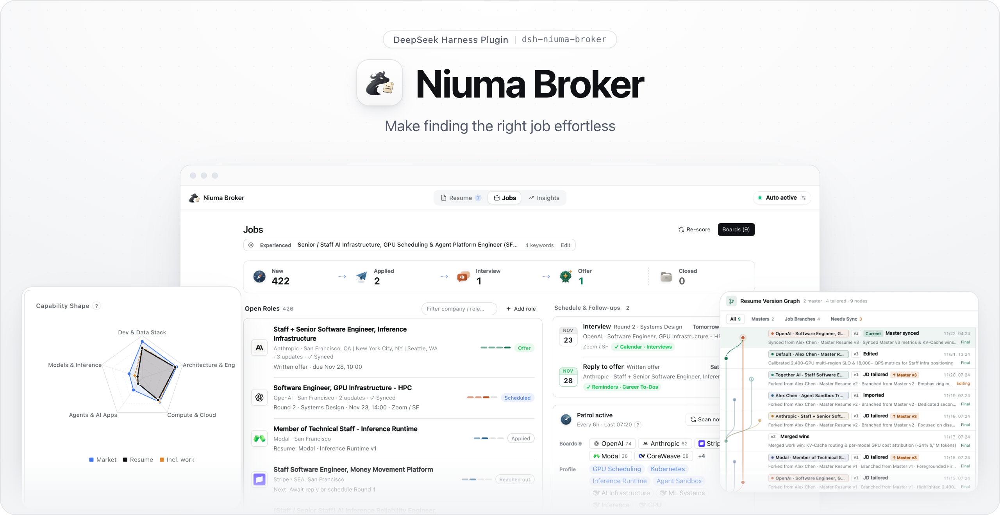
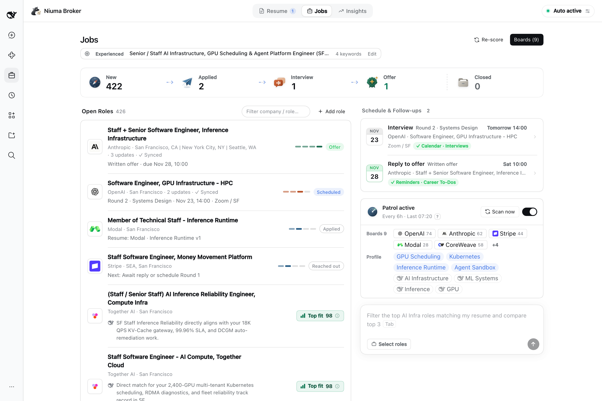
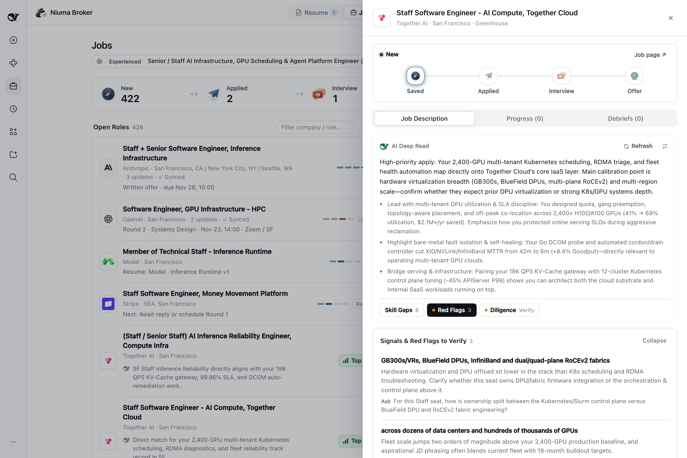
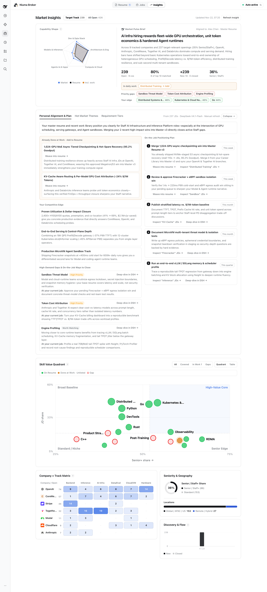
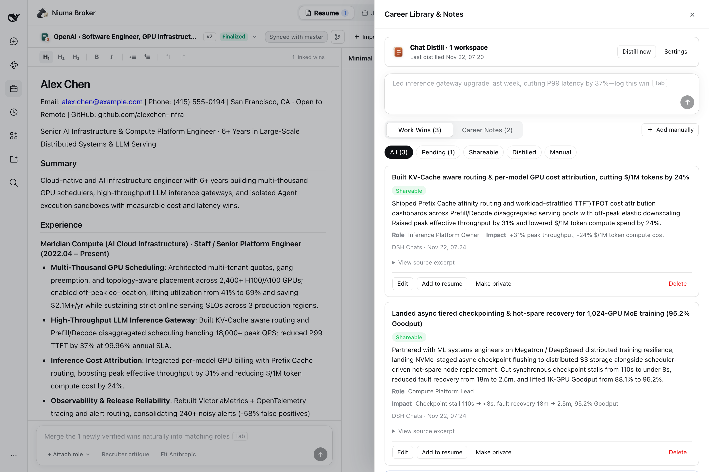
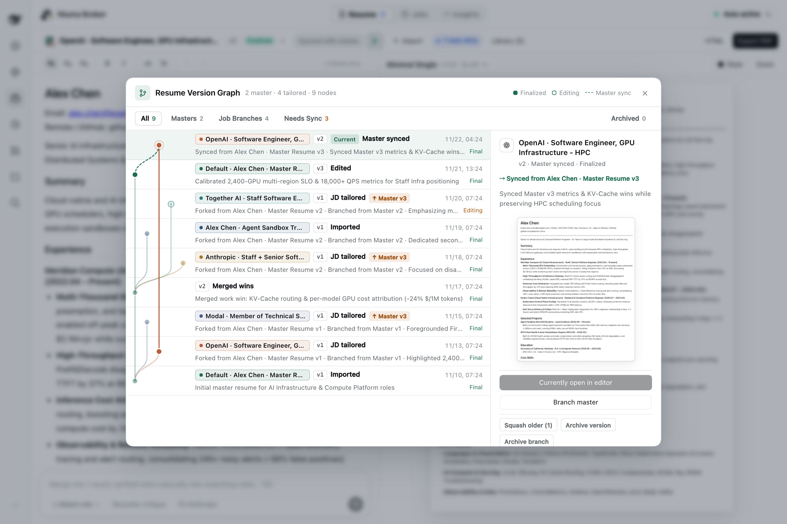
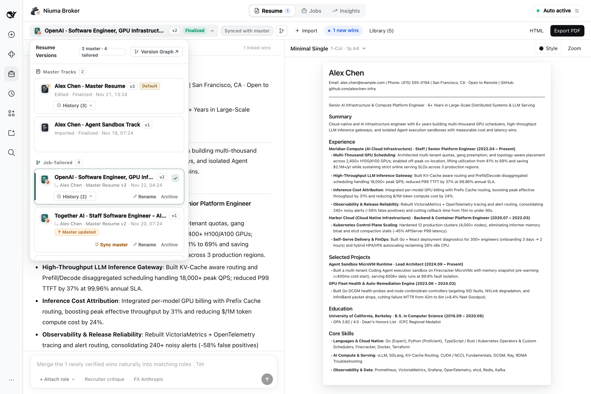
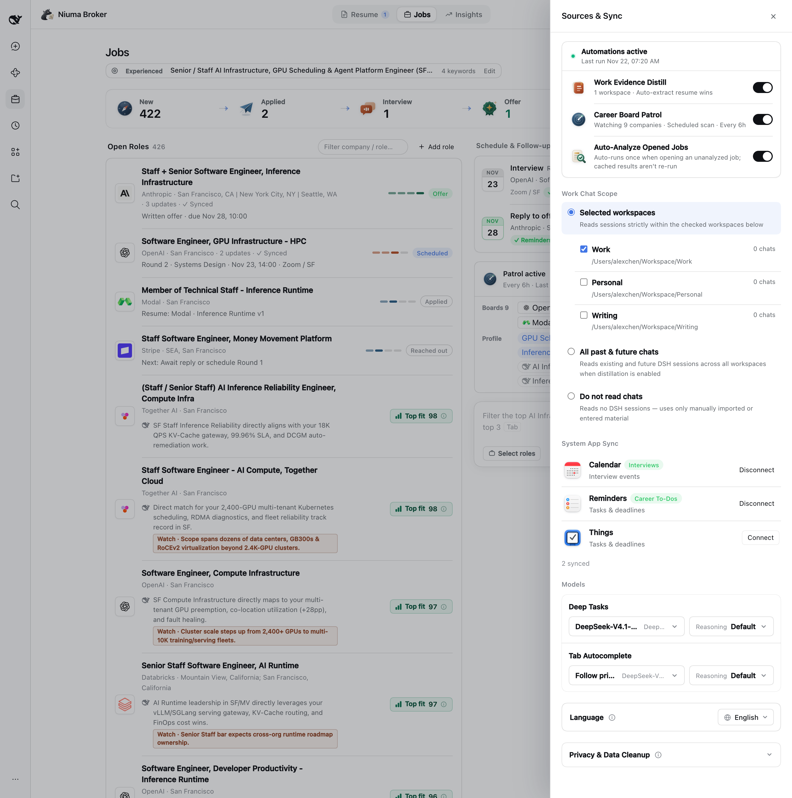

<div align="center">

<a href="#installation">
  
</a>

<br />

[](https://github.com/deepseek-ai/deepseek-harness)
[](#installation)
[](./LICENSE)

<p>
  <a href="./README.md">简体中文</a> · <b>English</b>
</p>

<p>
  <a href="#why-niuma-broker">Philosophy</a> ·
  <a href="#readme-job-search">Target &amp; Roles</a> ·
  <a href="#readme-market-insights">Market Insights</a> ·
  <a href="#readme-work-achievements">Work Achievements</a> ·
  <a href="#readme-feature-details">Feature Details</a> ·
  <a href="#installation">Install</a> ·
  <a href="#notes--license">Notes &amp; License</a>
</p>

</div>

---

## Why Niuma Broker

> Your resume is the least important link in the chain. Knowing your target, sensing the real temperature of the market, and feeding market demand back into what you invest in today and where your career heads next—all three matter far more than the resume itself.
>
> Put differently: when you keep researching, trying new things, and adjusting your judgment from real feedback to nail those three, it is hard for your resume *not* to stand out.
>
> So even though the entry point of this product is your resume, it is only a starting point—an initial signal. Every core capability is built around those three things:

---

<a name="readme-job-search"></a>

### 1. First, define your target and find roles that actually fit

<p align="center">
  
  <br />
  <sub>18 templates, role goals, and company career board patrols</sub>
</p>

<p align="center">
  
  <br />
  <sub>Git-style resume history and line-by-line review</sub>
</p>

<a name="readme-market-insights"></a>

### 2. Second, sense the market temperature and real hiring demand

<p align="center">
  
  <br />
  <sub>Market insights and actions to take at work</sub>
</p>

<p align="center">
  
  <br />
  <sub>AI job review, company research, and scheduling</sub>
</p>

<a name="readme-work-achievements"></a>

### 3. Most importantly, shape your daily work and capture high-value wins

<p align="center">
  
  <br />
  <sub>Capture achievements from daily work</sub>
</p>

> **In the end, everything falls into place naturally. To every builder and rising talent out there—wishing you a role you genuinely want to do!**

<a name="readme-feature-details"></a>

<details open>
<summary><b>Detailed features and screenshots</b></summary>

<table>
  <tr><th scope="col">Features and use cases</th><th scope="col">Screenshot</th></tr>
  <tr>
    <td width="60%" valign="top">
      <strong>Scheduled Career Board Patrol · AI Fit Scoring &amp; Schedule Sync</strong>
      <br /><br />
      • <b>Official career boards on autopilot</b>: Subscribe to target companies' public boards (Anthropic, OpenAI, Databricks, Modal, CoreWeave, Stripe, etc.) to pull fresh openings automatically<br />
      • <b>Honest, evidence-backed fit scores</b>: Scores each role against your real resume with a one-line match rationale and clear amber <code>Watch</code> flags for genuine gaps or scale jumps<br />
      • <b>End-to-end pipeline + native schedule</b>: Track New → Applied → Interview → Offer in one view, with interview times and offer deadlines synced straight to Apple Calendar &amp; Reminders
    </td>
    <td width="40%" valign="top">
      <a href="./docs/screenshots/en/01-jobs-matching.png">
        
      </a>
    </td>
  </tr>
  <tr>
    <td width="60%" valign="top">
      <strong>AI Deep Read · Red Flags &amp; Ready-to-Ask Interview Questions</strong>
      <br /><br />
      • <b>Grounded against your actual track record</b>: Open any role for a structured deep read separating real strengths from leveling or domain gaps<br />
      • <b>Actionable Red Flags</b>: Flags hidden scope traps, multi-org trade-offs, and scale leaps—each paired with a <b>concrete interview question</b> to ask the hiring manager<br />
      • <b>Trace every claim back to the JD</b>: Jump directly to the exact sentence in the original job description before deciding to apply
    </td>
    <td width="40%" valign="top">
      <a href="./docs/screenshots/en/02-job-detail.png">
        
      </a>
    </td>
  </tr>
  <tr>
    <td width="60%" valign="top">
      <p><strong>Turn live job descriptions into a real-time market radar</strong></p>
      <p>Skip vague industry hot takes—measure what top teams are actively hiring and paying a Staff premium for directly from live openings matched to your direction.</p>
      <hr />
      <p>
      <b>① 5-Axis Capability Radar · With "Done at Work" Overlay</b><br />
      Compare <b>Market demand</b> (blue), <b>Current resume</b> (black), and <b>Done at work</b> (dashed amber) on one chart—instantly spotting high-value skills you already shipped at work but haven't added to your resume yet (e.g. <code>Distributed Training → Add</code>).
      </p>
      <p>
      <b>② AI Strategy Brief · Weekly / Monthly / Quarterly Action Plan</b><br />
      Separates your competitive edge from high-demand gaps, turning them into concrete on-the-job positioning moves—each linked directly to weaving wins into your resume, filtering matching JDs, or starting a deep-dive study session in DSH.
      </p>
      <p>
      <b>③ 2D Skill Value Quadrant (JD Share × Senior+ Share)</b><br />
      Maps Broad Baselines, Senior Differentiators, and High-Value Core skills—color-coded by On Resume (green), Done at Work / Unlisted (amber), and True Gaps (red).
      </p>
      <p>
      <b>④ Company × Track Matrix &amp; Seniority Geography</b><br />
      Compare hiring density across tracks, Senior/Staff share, remote vs. hub distribution, and posting velocity before picking where to focus your energy.
      </p>
    </td>
    <td width="40%" valign="top">
      <a href="./docs/screenshots/en/03-market-insights-full.png">
        
      </a>
      <p align="center"><sub>Click to view full-resolution panorama (<code>2880 × 6458</code>)</sub></p>
    </td>
  </tr>
  <tr>
    <td width="60%" valign="top">
      <strong>Quiet Work-Win Distillation · Review-Before-Use Career Library</strong>
      <br /><br />
      • <b>Capture wins as you ship</b>: Reads only the work folders you explicitly authorize to distill resume-worthy engineering impact and career reflections<br />
      • <b>Strict fact guardrails</b>: New wins land in a <code>Pending</code> queue—zero fabricated metrics, never added to any resume until you review and mark them <code>Shareable</code><br />
      • <b>Source excerpts &amp; one-click weave</b>: Every entry keeps its original excerpt for verification and weaves cleanly into your master or tailored resumes
    </td>
    <td width="40%" valign="top">
      <a href="./docs/screenshots/en/04-work-evidence.png">
        
      </a>
    </td>
  </tr>
  <tr>
    <td width="60%" valign="top">
      <strong>Multi-Master &amp; Role-Tailored Branches · Resume Version Graph</strong>
      <br /><br />
      • <b>Separate master tracks from job branches</b>: Evolve your core master resume cleanly (<code>v1 → v2 → v3</code>) while branching dedicated versions for specific roles or tracks<br />
      • <b>One-click master sync</b>: When your master incorporates a new work win, the graph highlights stale role branches (<code>↑ Master v3</code>) and syncs updated metrics while preserving tailored structure<br />
      • <b>Full lineage preview &amp; archiving</b>: Inspect any version's miniature A4 layout, squash old intermediates, or archive and restore branches anytime
    </td>
    <td width="40%" valign="top">
      <a href="./docs/screenshots/en/05-resume-branch-graph.png">
        
      </a>
    </td>
  </tr>
  <tr>
    <td width="60%" valign="top">
      <strong>Instant Version Switcher · New Wins Alert &amp; Live A4 Preview</strong>
      <br /><br />
      • <b>Organized version library</b>: Switch seamlessly between Master Tracks and Job-Tailored versions with inline <code>Sync master</code> controls<br />
      • <b>Never leave fresh impact behind</b>: Top bar surfaces <code>● 1 new wins</code> whenever newly distilled work achievements are ready to review<br />
      • <b>Conversational editing + crisp PDF export</b>: Chat to tailor with Tab autocomplete and line-by-line diff review, while previewing live A4 layouts and exporting print-ready PDFs
    </td>
    <td width="40%" valign="top">
      <a href="./docs/screenshots/en/06-resume-workspace.png">
        
      </a>
    </td>
  </tr>
  <tr>
    <td width="60%" valign="top">
      <strong>Folder-Level Privacy · Calendar/Reminders Sync &amp; Model Routing</strong>
      <br /><br />
      • <b>Check only the folders you choose</b>: Authorize only <code>Work</code> while keeping <code>Personal</code> and <code>Writing</code> completely untouched; toggle all three background automations independently<br />
      • <b>Native macOS Calendar &amp; Reminders sync</b>: Connect Apple Calendar, Reminders (and Things) directly to sync interviews and offer reply deadlines automatically<br />
      • <b>Independent model &amp; reasoning routing</b>: Configure deep analysis and lightweight Tab autocomplete models (e.g. <code>DeepSeek-V4.1-Flash</code>) and reasoning effort separately
    </td>
    <td width="40%" valign="top">
      <a href="./docs/screenshots/en/07-settings-automation.png">
        
      </a>
    </td>
  </tr>
</table>

</details>

---

## Installation

> **Tell your Agent this project link — it knows how to install it.**

<details>
<summary><b>Manual install options &amp; requirements</b> (click to expand)</summary>

<br />

Requires [DeepSeek Harness](https://github.com/deepseek-ai/deepseek-harness) `>=0.2.2-rc.5 <0.3.0` and Node.js `>=22`.

- **Option 1: Install in DeepSeek Harness Desktop / Web UI (recommended)**
  Open DeepSeek Harness → **Plugins** in the sidebar → **Add plugin** → enter:
  - `dsh-niuma-broker` (once published to npm), or
  - the **absolute local path** to the downloaded `dsh-niuma-broker-0.1.0.tgz` archive from GitHub Releases
  Click **Install**, then **Enable now**.

- **Option 2: Install via DSH CLI (`--profile` is required on DSH `0.2.2-rc.5`)**
  - **Desktop profile (`desktop`)**: Open DeepSeek Harness Desktop once to initialize its profile, **fully quit** it, run one of the commands below, then reopen Desktop:

```bash
# From a downloaded Releases tarball
dsh plugin --profile desktop add /path/to/dsh-niuma-broker-0.1.0.tgz

# Or from npm (once published)
dsh plugin --profile desktop add dsh-niuma-broker
```

  - **Web profile (`web`)**:

```bash
# From a downloaded Releases tarball
dsh plugin --profile web add /path/to/dsh-niuma-broker-0.1.0.tgz

# Or from npm (once published)
dsh plugin --profile web add dsh-niuma-broker
```

> If `dsh` is not on your `PATH`, the bundled macOS CLI binary is at `/Applications/DeepSeek Harness.app/Contents/Resources/runtime/cli/bin/dsh`.
>
> Configure at least one model in DSH Settings before using AI features (manual editing and local organization work without a model). Best experience is on **macOS** (native Calendar, Reminders, and Things sync); Linux and Windows support core resume, job tracking, and market insights workflows.

</details>

---

## Notes & License

- **Data & Model Calls**: There is no separate backend server—resumes, career wins, and job records are stored on your machine under `~/.dsh/profiles/<profile>/career-broker/`. When you use AI scoring, deep reads, or work-win distillation, the relevant context is sent to the model provider you configured in DSH.
- **Opt-In & Scoped**: Background session distillation, career board patrols, and auto-analysis on open all start **OFF** until enabled. Work capture is scoped to the specific workspace folders you check—never authorize folders containing NDA-restricted confidential material. The plugin never simulates logins or auto-applies on your behalf.
- **Disclaimer & License**: Built-in company directories are public career-page shortcuts with no affiliation to listed employers; always verify AI suggestions before applying. Released under the [MIT License](./LICENSE); third-party notices in [THIRD_PARTY_NOTICES.md](./THIRD_PARTY_NOTICES.md).
- Community link · [LINUX DO](https://linux.do/)
